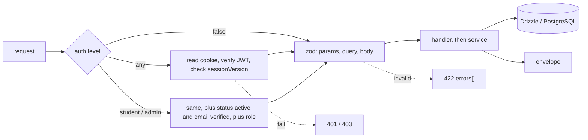
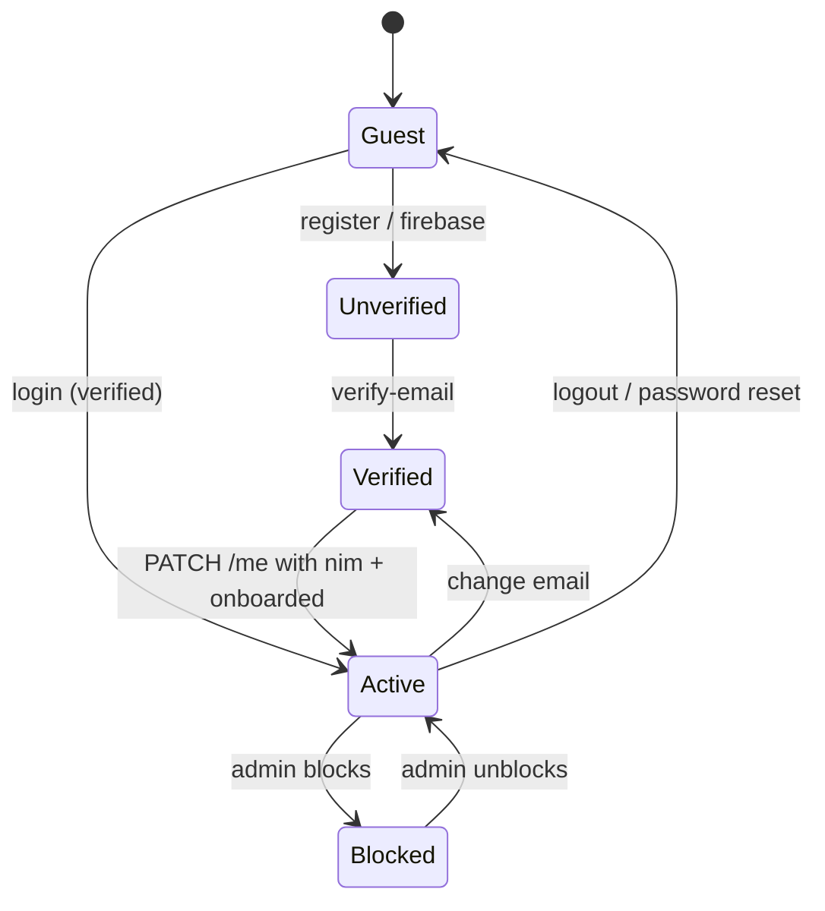
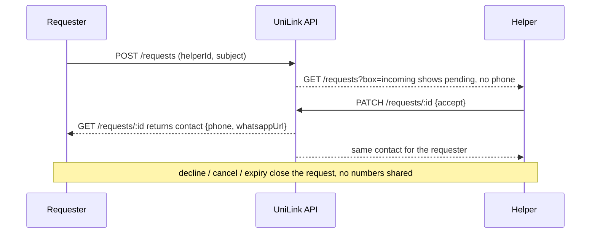
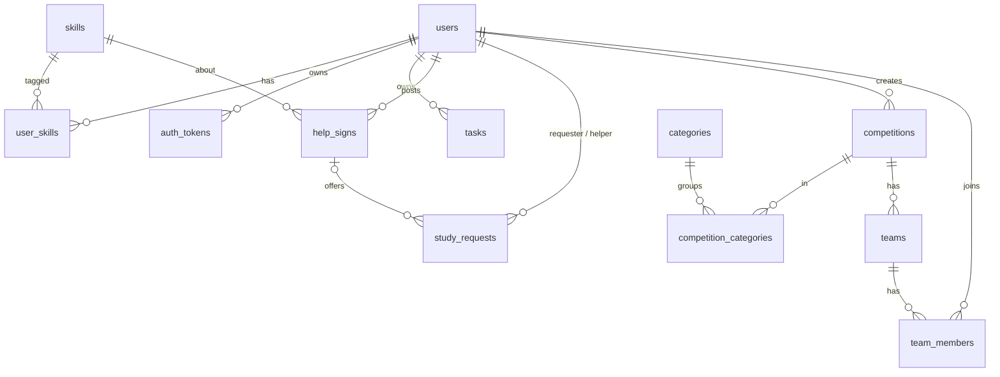

# UniLink API

Base path `/api/v1`. JSON in, JSON out. Importable collection with examples: [`postman/`](postman/).

## Contract

Every route is wrapped in `defineApi({ auth, params, query, body, status, message }, handler)`.

```json
{ "success": true, "statusCode": 200, "message": "Success", "data": {}, "timestamp": "…" }
{ "success": false, "statusCode": 422, "message": "Validation failed", "errors": [{ "field": "nim", "message": "NIM is required" }], "timestamp": "…" }
```

| Code | Meaning |
| ---- | ------- |
| 200 / 201 | ok / created |
| 401 | no or expired session |
| 403 | wrong role, blocked, or email not verified |
| 404 | not found, or not yours (ownership is never leaked) |
| 409 | conflict: duplicate email or NIM, NIM locked, already requested, team full |
| 422 | validation failed (`errors[]` names the field) |
| 429 | rate limited |
| 503 | optional service not configured (Firebase) |

Lists share `?page=&limit=` and answer with `{ items | <name>, total, page, limit }`.

## Request pipeline



Services throw `fail("CODE")`; the code maps to status and message in `server/utils/errors.js`. Postgres constraint names (for example `users_nim_unique`) map to friendly 409s.

## Sessions

- `unilink_session`: httpOnly, sameSite lax, secure in production. HS256 JWT (jose), 7 days, 30 with `remember`.
- `sessionVersion` on the user bumps on password change, reset and block, which signs out every other device.
- Verify-email tokens live 24 h, reset tokens 30 min. Only the SHA-256 hash is stored and each works once.
- Rate limits (in memory, per process): login 8 / 15 min, forgot 3 / h, verification mail 5 / h, firebase 30 / 15 min.



## Routes

Auth column: `-` public, `any` signed in (even if unverified), `student` verified student, `admin` verified admin.

### Auth and account

| Method | Path | Auth | Notes |
| ------ | ---- | ---- | ----- |
| GET | `/health` | - | API and DB up |
| POST | `/auth/register` | - | `{name,email,password}` creates the account, logs in, sends verification mail |
| POST | `/auth/login` | - | `{email,password,remember?}` sets the cookie |
| POST | `/auth/logout` | - | clears the cookie |
| POST | `/auth/verify-email` | - | `{token}` |
| POST | `/auth/resend-verification` | any | 5 per hour |
| POST | `/auth/forgot` | - | always succeeds, so emails cannot be probed |
| POST | `/auth/reset` | - | `{token,password}` signs out other sessions |
| POST | `/auth/firebase` | - | `{idToken,name?,remember?}` checked against Google JWKS; 503 without config |
| GET | `/dev/outbox` | - | mails sent in development only |
| GET | `/me` | any | user, skills, onboarding state |
| PATCH | `/me` | any | `fullName, phone (+62), nim, year, major, bio, personalWebsite, profilePhotoUrl, skills[], onboarded` |
| PATCH | `/me/email` | any | needs current password; re-verification required |
| PATCH | `/me/password` | any | bumps `sessionVersion`, reissues cookie |

`nim`: 8 to 15 digits, required to finish onboarding, settable once (a different value later gives 409 `NIM_LOCKED`), unique across users. `year` is also locked after onboarding.

### Directory (student)

| Method | Path | Notes |
| ------ | ---- | ----- |
| GET | `/student/skills`, `/student/skills/:id` | reference list |
| GET | `/student/categories` | reference list |
| GET | `/student/users` | search students: `q, skillIds, year, major` |
| GET | `/student/users/:id` | public profile, never includes the phone |
| GET | `/student/dashboard` | counts, pending requests, teams, upcoming tasks, activity |

### Study match (student)

| Method | Path | Notes |
| ------ | ---- | ----- |
| GET | `/student/study-match/search` | helpers by skill, year, major |
| POST | `/student/study-match/requests` | `{helperId,subject,description,preferredTime?}` |
| GET | `/student/study-match/requests` | `box=incoming\|outgoing`, `status` |
| GET | `/student/study-match/requests/:id` | `contact` appears only once accepted |
| PATCH | `/student/study-match/requests/:id` | `{action: accept \| decline \| cancel}`, only the receiver can accept or decline |
| DELETE | `/student/study-match/requests/:id` | remove a finished request |
| GET | `/student/study-match/history` | `role=all\|helper\|requester` |
| GET / POST | `/student/study-match/help-signs` | `scope=board\|mine`, `skillId`, `q`, `status` |
| GET / PATCH / DELETE | `/student/study-match/help-signs/:id` | owner edits, anyone reads |
| POST | `/student/study-match/help-signs/:id/offer` | creates a helper-initiated request on the sign; own sign gives 422 |



Help sign flow: a seeker posts a sign, a helper sends an offer (request with `initiatedBy = helper`), and the **sign owner** accepts. When it is accepted the sign becomes `fulfilled`.

### Competitions and teams (student)

| Method | Path | Notes |
| ------ | ---- | ----- |
| GET / POST | `/student/competitions` | list: `q, categoryId, state, sort, mine`; students create `draft`/`published` ones of their own |
| GET / PATCH / DELETE | `/student/competitions/:id` | detail includes teams; edit and delete only by creator |
| GET / POST | `/student/teams` | mine / create for a competition |
| GET / PATCH / DELETE | `/student/teams/:id` | owner edits and deletes |
| POST | `/student/teams/:id/join` | request to join, 409 when full or already asked |
| DELETE | `/student/teams/:id/leave` | leave or cancel a pending request |
| GET | `/student/teams/:id/members` | phones only for accepted members |
| GET | `/student/teams/:id/requests` | owner: pending join requests |
| PATCH | `/student/teams/:id/members/:userId` | owner: `{decision: accept \| decline \| remove}` |
| PATCH | `/student/teams/:id/result` | `{result: won \| lost \| unknown}`, only after the competition closed, else 409 |

### Tasks (student, private to the user)

| Method | Path | Notes |
| ------ | ---- | ----- |
| GET | `/student/tasks` | `status=open\|overdue\|done\|all`, `priority`, `q`, `sort`; returns `tasks` and `summary {open, overdue, done}` |
| POST | `/student/tasks` | `{title, notes?, course?, dueDate?, priority: low\|medium\|high}` |
| PATCH | `/student/tasks/:id` | any field, or `{completed}` |
| DELETE | `/student/tasks/:id` | |
| DELETE | `/student/tasks/completed` | clear all done |

### Admin

| Method | Path | Notes |
| ------ | ---- | ----- |
| GET | `/admin/dashboard` | totals, signups per month, status breakdown, top skills |
| GET | `/admin/users`, `/admin/users/:id` | filters `q, role, status, year` |
| PATCH / DELETE | `/admin/users/:id` | admin may correct a NIM |
| PATCH | `/admin/users/:id/status` | `{status: active \| blocked, reason}`; blocking needs a reason and signs the user out |
| GET / POST | `/admin/skills`, `/admin/categories` | CRUD |
| GET / PATCH / DELETE | `/admin/skills/:id`, `/admin/categories/:id` | delete is refused while in use unless `force=true` |
| GET / POST | `/admin/competitions` | CRUD, `status: draft \| published \| closed` |
| GET / PATCH / DELETE | `/admin/competitions/:id` | |

## Data model



| Enum | Values |
| ---- | ------ |
| user role / status | `student, admin` / `active, blocked` |
| study request status | `pending, accepted, declined, expired, cancelled` |
| study request initiator | `requester, helper` |
| help sign status | `open, fulfilled, closed, expired` |
| competition status | `draft, published, closed` |
| team member status | `pending, accepted` |
| team result | `unknown, won, lost` |
| task priority | `low, medium, high` |
| auth token type | `verify_email, reset_password` |

Deleting a user cascades to their skills, tokens, tasks, signs, requests and memberships.

## Database scripts

| Script | Does |
| ------ | ---- |
| `bun run db:migrate` | apply `server/database/migrations` (starts with `pg_trgm`) |
| `bun run db:seed` | demo data: 40 students, signs, requests, competitions, teams, tasks |
| `bun run db:clean` | drop schemas `public` and `drizzle` |
| `bun run db:reset` | clean, migrate, seed; needs `ALLOW_DB_RESET="true"` |

`DATABASE_SSL`: `true` forces TLS, `false` disables it, unset means off for localhost and on for remote hosts.

## Configuration

| Variable | Purpose |
| -------- | ------- |
| `DATABASE_URL` | PostgreSQL connection string |
| `AUTH_SECRET` | JWT signing key, 32+ characters |
| `APP_URL`, `NUXT_PUBLIC_SITE_URL` | links in mails, canonical and sitemap origin |
| `RESEND_API_KEY` | real mail; empty means the dev outbox |
| `ALLOWED_EMAIL_DOMAINS` | comma list to restrict sign-ups |
| `NUXT_PUBLIC_FIREBASE_*`, `FIREBASE_PROJECT_ID` | optional Google sign-in |
