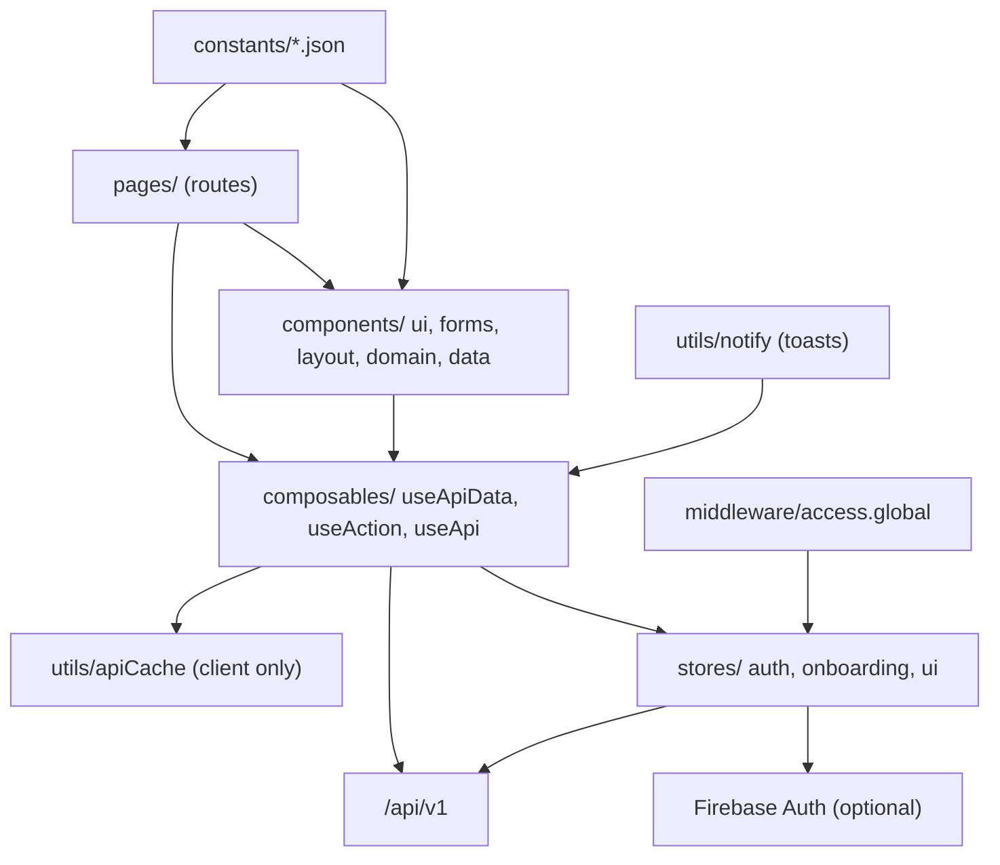
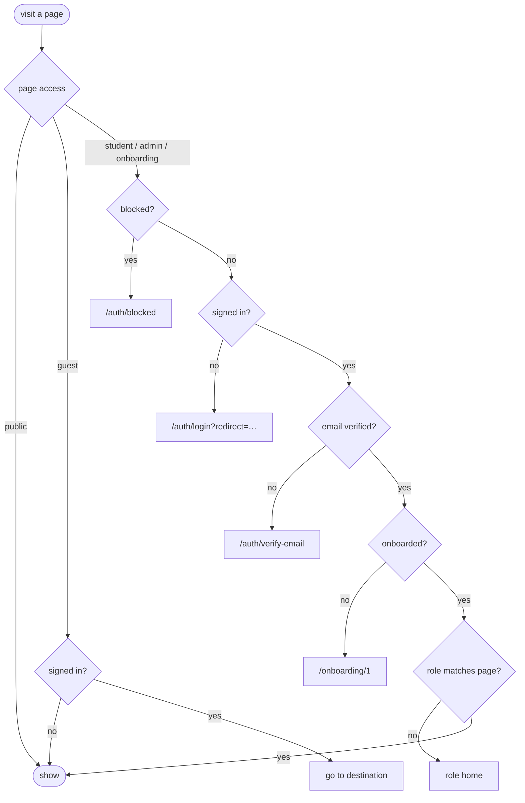
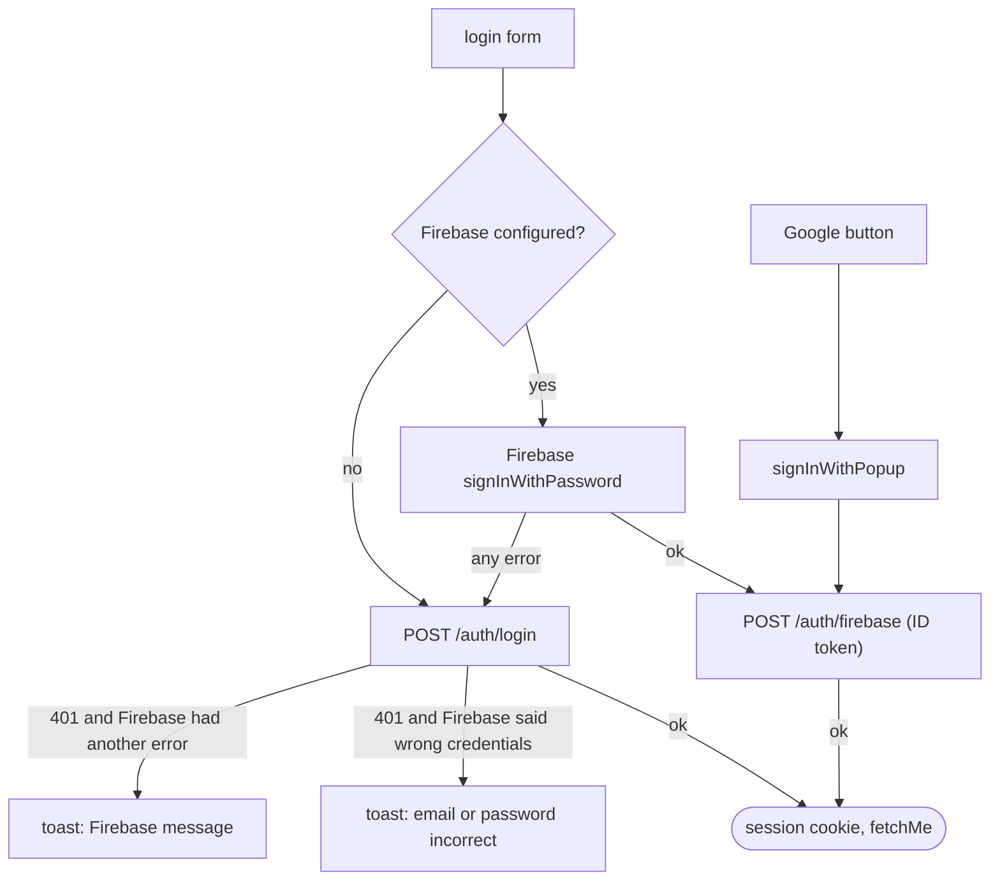
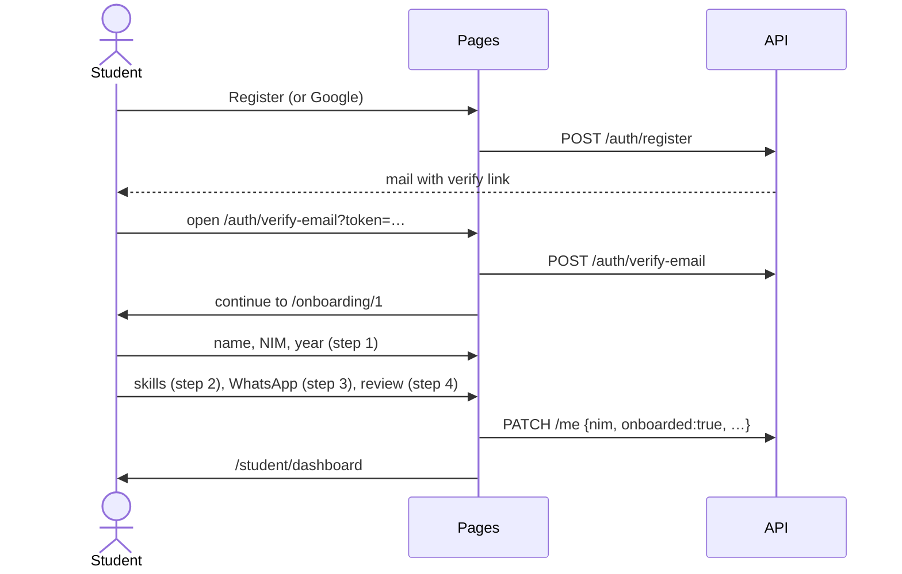
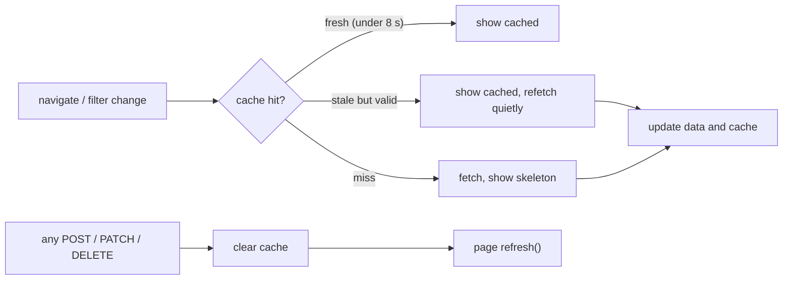
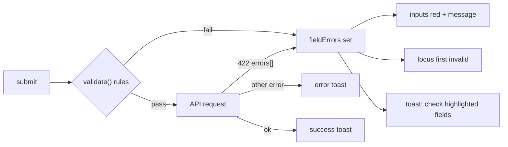
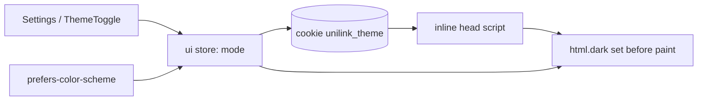
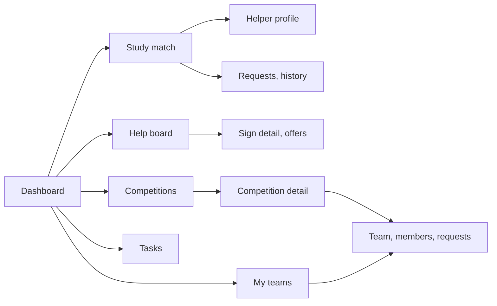

# UniLink app

How the Nuxt client is built and how its pieces talk to each other. Endpoint details are in [API.md](API.md), setup is in the [README](README.md).

**Contents:** [At a glance](#at-a-glance) · [Layers](#layers) · [Folders](#folders) · [Pages](#pages) · [Access control](#access-control) · [Sign-in](#sign-in) · [Account journey](#account-journey) · [Data loading](#data-loading) · [Forms, errors and toasts](#forms-errors-and-toasts) · [Theme](#theme) · [Layouts and responsive rules](#layouts-and-responsive-rules) · [Components](#components) · [Composables and stores](#composables-and-stores) · [Student screens](#student-screens) · [Admin screens](#admin-screens) · [SEO](#seo) · [Run and test](#run-and-test) · [Troubleshooting](#troubleshooting)

## At a glance

| Topic     | Choice                                                                   |
| --------- | ------------------------------------------------------------------------ |
| Framework | Nuxt 4 (SSR), Vue `<script setup>` in plain JS                           |
| Styling   | UnoCSS, De Stijl tokens in `assets/css/tokens.css`, light and dark       |
| State     | Pinia (`auth`, `onboarding`, `ui`)                                       |
| Feedback  | vue-sonner toasts only                                                   |
| Auth      | Cookie session from the API; optional Firebase (email and Google) on top |
| Aliases   | `@app/`, `@server/`, `@database/`; no multi-level relative imports       |
| Copy      | JSON in `app/constants/`, never inline in templates                      |
| Classes   | static strings use the compile-class prefix: `class=":uno: flex gap-4"`  |

## Layers



## Folders

```
app/
  pages/        public pages, auth/, onboarding/, student/, admin/
  layouts/      default (public) · auth · student · admin
  components/   ui · forms · layout · domain · data
  composables/  useApi · useApiData · useAction · useLocalCheck · useFieldState
                useAdminCrud · useSearchPage · useSkillOptions · useCategoryOptions
                useFirebaseAuth · usePageSeo
  stores/       auth · onboarding · ui
  middleware/   access.global.js
  utils/        apiCache · fieldError · focus · format · nav · notify
  constants/    *.json copy and options, icons.js
  assets/css/   tokens.css (light + dark), base.css
```

## Pages

| Area       | Routes                                                                                                                               | `access`     |
| ---------- | ------------------------------------------------------------------------------------------------------------------------------------ | ------------ |
| Public     | `/`, `/how-it-works`, `/help`, `/privacy`, `/terms`, `/offline`, `/maintenance`                                                      | none         |
| Auth       | `/auth/login`, `/register`, `/forgot`, `/reset`                                                                                      | `guest`      |
| Auth       | `/auth/verify-email`                                                                                                                 | `verify`     |
| Auth       | `/auth/blocked`                                                                                                                      | `blocked`    |
| Onboarding | `/onboarding/[step]` (1 to 4)                                                                                                        | `onboarding` |
| Student    | `/student/dashboard`, `study-match` (+ `helpers`, `requests`, `history`), `help-board`, `competitions`, `teams`, `tasks`, `settings` | `student`    |
| Admin      | `/admin`, `/admin/users`, `/admin/users/[id]`, `/admin/skills`, `/admin/categories`, `/admin/competitions`                           | `admin`      |

## Access control

One global middleware reads `definePageMeta({ access })` and decides from the session state.

| `access`     | Who may enter                                        | Otherwise                                           |
| ------------ | ---------------------------------------------------- | --------------------------------------------------- |
| none         | everyone                                             | -                                                   |
| `guest`      | signed-out visitors                                  | signed-in users go to `auth.destination`            |
| `verify`     | unverified users, or anyone holding a `?token=` link | verified users go to `destination`, others to login |
| `onboarding` | verified, not yet onboarded                          | onboarded users go home                             |
| `student`    | verified, onboarded student                          | role or state mismatch goes to `destination`        |
| `admin`      | verified admin                                       | wrong role goes to its own home                     |
| `blocked`    | blocked accounts                                     | everyone else leaves                                |



`auth.destination` answers "where does this user belong": blocked, login, verify-email, onboarding, or home (`/student/dashboard`, `/admin`). After login, `auth.landing(redirect)` honours the `redirect` query only for a fully ready user and an internal path.

## Sign-in

Email and password always work, with or without Firebase. When Firebase is configured the client tries it first and falls back to the local account on any Firebase failure, so seeded and normally registered accounts are never locked out.



| Case                                | What happens                                                                      |
| ----------------------------------- | --------------------------------------------------------------------------------- |
| Firebase env empty                  | only `POST /auth/login`; Google button is hidden                                  |
| Account made with the register form | works in both modes through the local fallback                                    |
| Account made with Google            | works through Firebase only; there is no local password until the user resets one |
| Blocked account                     | both paths end at `/auth/blocked`                                                 |

The server links a Firebase identity to an existing user by email, so the same person never gets two accounts.

## Account journey



Onboarding keeps its draft in the `onboarding` store. NIM is typed once; when the account already has one the field is read-only.

## Data loading

Pages call `useApiData(key, path, { query, transform, default, watch })`, a thin wrapper over `useLazyAsyncData`.



- The cache is in memory and client only: 60 s for normal data, 10 min for skills and categories.
- A mutation clears everything except reference data. `/auth/*` and `/me/*` clear all, so one user never sees another's data after switching accounts.
- Identical GETs fired together share one request.
- A failed load shows an error toast, except 401 which the middleware handles on the next navigation.

## Forms, errors and toasts

All feedback is a toast. `UiCallout` remains only for static guidance (how it works, etiquette, blocked reason).



| Piece                                          | Role                                                                                                |
| ---------------------------------------------- | --------------------------------------------------------------------------------------------------- |
| `notifySuccess`, `notifyInfo`, `notifyError`   | the only feedback API; copy in `constants/toast.json`, server messages mapped through `apiMessages` |
| `useAction(fn, { success, silent, validate })` | pending flag, field errors, toasts, local validation                                                |
| `useLocalCheck(serverErrors)`                  | for modals: merges local and server errors, focuses the first bad field                             |
| `FormField`                                    | label, hint, error text; provides `fieldInvalid` to its input                                       |
| `useFieldState`                                | used by every input to read `invalid` and `aria-describedby` from `FormField`                       |
| `utils/fieldError.js`                          | `rule.required`, `rule.min`, `collect`, `translateError`, `firstErrors`                             |
| `constants/validation.json`                    | Indonesian messages for local rules and for zod messages from the API                               |

Invalid inputs get a red border and soft red background, a red label and an `aria-invalid` flag. Native browser validation is off (`novalidate`) so the app's own messages always show.

## Theme



- Modes: `light`, `dark`, `system`. `system` follows the OS live.
- Tokens are CSS variables in `tokens.css`; UnoCSS colours point at them, so components never hard-code a theme.
- The sun and moon button sits in every header. Settings has the three-way choice.

## Layouts and responsive rules

| Layout    | Below 1024 px                                                                                                                    | From 1024 px |
| --------- | -------------------------------------------------------------------------------------------------------------------------------- | ------------ |
| `default` | `PublicNav` with a menu sheet                                                                                                    | full nav     |
| `auth`    | `AuthFrame`                                                                                                                      | `AuthFrame`  |
| `student` | `MobileHeader` + `BottomNav` (5 tabs)                                                                                            | sidebar      |
| `admin`   | header with theme and menu button; the menu opens `AdminDrawer` (the same sidebar, slide-over, closes on route change or Escape) | sidebar      |

`student` and `admin` are `h-dvh overflow-hidden`: only `main` scrolls and the scroll resets on route change. The active nav item is the longest matching link.

| Component   | Phone                                                                            | Desktop                         |
| ----------- | -------------------------------------------------------------------------------- | ------------------------------- |
| `DataTable` | stacked cards (first column as title, others as label and value, select-all row) | table with fixed columns        |
| `ChartBars` | bars with tap or focus tooltips                                                  | hover tooltips (`label: value`) |

## Components

| Group    | Pieces                                                                                                                                            |
| -------- | ------------------------------------------------------------------------------------------------------------------------------------------------- |
| `ui`     | `UiModal`, `UiButton`, `UiIconButton`, `UiCard`, `UiChip`, `UiTabs`, `UiToggle`, `UiCheckbox`, `UiCallout`, `UiEmpty`, `UiAvatar`, `UiPagination` |
| `forms`  | `FormField`, `FormInput`, `FormTextarea`, `FormSelect`, `FormChoice`, `SkillPicker`, `GoogleButton`                                               |
| `layout` | `SidebarNav`, `AdminDrawer`, `MobileHeader`, `BottomNav`, `WorkspaceHeader`, `PublicNav`, `ThemeToggle`, `AuthFrame`                              |
| `domain` | cards, rows and modals for study match, competitions, teams, tasks                                                                                |
| `data`   | `DataTable`, `ChartBars`, `StatCard`, `AdminList`, `EntityModal`, `ReasonModal`, `ConfirmModal`                                                   |

`FormInput` shows its own eye button for password fields. Firefox draws a native reveal button too, so the custom one is hidden there to avoid a double icon.

## Composables and stores

| Name                | What it does                                                                            |
| ------------------- | --------------------------------------------------------------------------------------- |
| `useApi`            | `get/post/patch/put/del`, throws `ApiRequestError` with `statusCode` and field `errors` |
| `useApiData`        | cached, SSR-safe loading with skeleton state                                            |
| `useAction`         | mutation wrapper described above                                                        |
| `useAdminCrud`      | list, create, edit, delete flow shared by skills and categories                         |
| `useSearchPage`     | query, filters and pagination in the URL                                                |
| `useFirebaseAuth`   | lazy Firebase SDK: password, Google, sign-up, reset, verify                             |
| `stores/auth`       | user, `destination`, `landing()`, `login`, `register`, `logout`, `syncVerification`     |
| `stores/onboarding` | draft for the four onboarding steps                                                     |
| `stores/ui`         | theme mode and the admin drawer flag                                                    |

## Student screens



- **Tasks:** one list with tabs (active, overdue, done, all), a priority bar per row, add and edit in a modal.
- **Help board:** only the sign owner sees Accept and Decline on offers; a helper sees the status of their own offer.
- **Contacts:** phone and WhatsApp appear only after acceptance.

## Admin screens

| Screen             | Content                                                               |
| ------------------ | --------------------------------------------------------------------- |
| Dashboard          | stat cards, signups per month and request status charts with tooltips |
| Users              | search, status filter, block with reason, edit, detail page           |
| Skills, Categories | list with create, edit, delete (force delete when in use)             |
| Competitions       | review, publish, close, delete                                        |

## SEO

`@nuxtjs/robots`, `@nuxtjs/sitemap`, `nuxt-schema-org`, `nuxt-seo-utils` (not the `@nuxtjs/seo` bundle, because `nuxt-og-image` breaks under Bun). `usePageSeo(key)` reads `constants/seo.json`. Private routes are `noindex` through `routeRules`. The share image is the static `public/og-image.png`; set `NUXT_PUBLIC_SITE_URL` in production.

## Run and test

```bash
bun install
bun run db:reset
bun run dev
```

Demo logins are in the [README](README.md). The API collection (`api-tester/`) contains backup Postman and API Dog requests.
