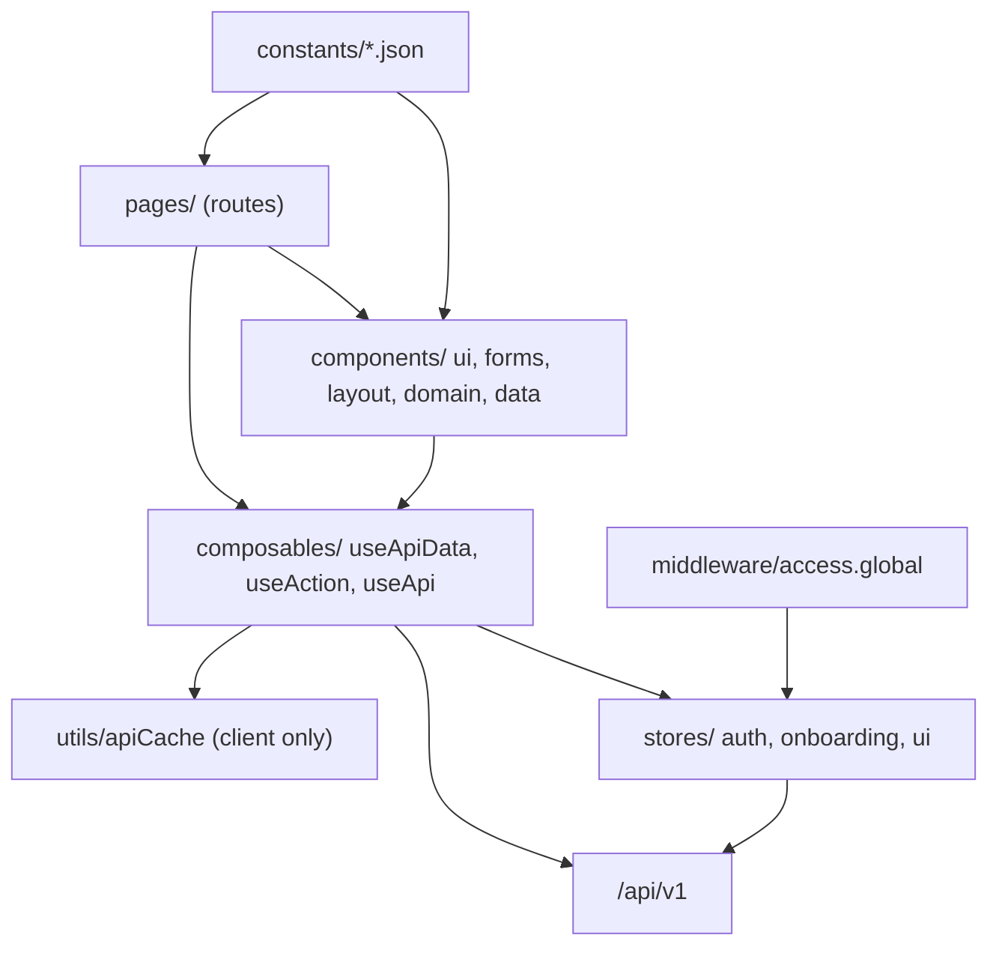
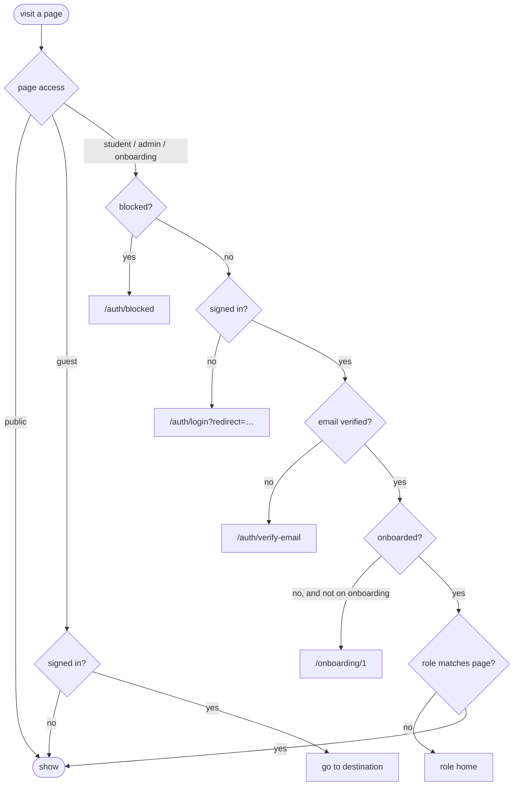
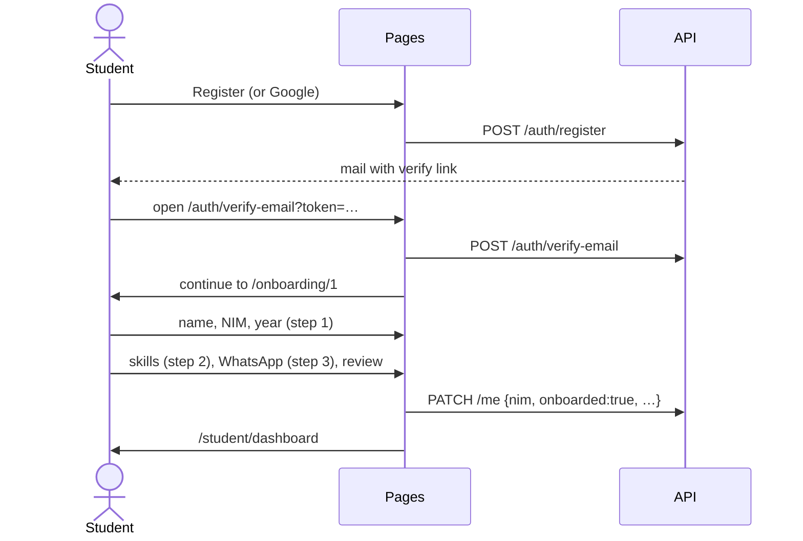
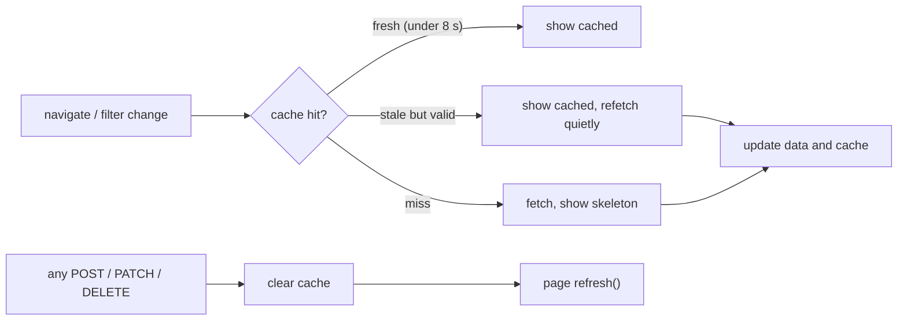
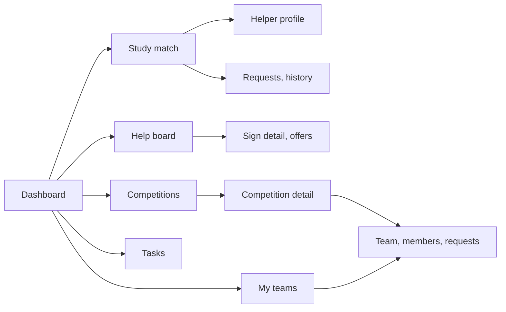

# UniLink app

How the Nuxt client is put together. API details live in [API.md](API.md).

## Stack and rules

Nuxt 4 (SSR), UnoCSS, Pinia, vue-sonner, optional Firebase Auth. Everything is `<script setup>` in plain JS.

- Aliases: `@app/`, `@server/`, `@database/`. No multi-level relative imports.
- Copy lives in `app/constants/*.json`, not in templates.
- Styling: UnoCSS utilities. Static classes use the compile-class prefix (`class=":uno: flex gap-4"`), so each element compiles to one short class. Dynamic strings follow the same pattern.
- Design source of truth: the De Stijl Figma file. Flat blocks, thick outlines, the tri-colour strip on modals.

## Layers



## Folders

```
app/
  pages/        index, how-it-works, help, privacy, terms, offline, maintenance
    auth/       login, register, forgot, reset, verify-email, blocked
    onboarding/ [step]
    student/    dashboard, study-match (+helpers, requests, history), help-board, competitions, teams, tasks, settings
    admin/      index, users, skills, categories, competitions
  layouts/      default (public), auth, student, admin
  components/   ui (primitives), forms, layout (nav, headers), domain (cards, rows, modals), data (tables, stats)
  composables/  useApi, useApiData, useAction, useAdminCrud, useSearchPage, useSkillOptions, useCategoryOptions, useFirebaseAuth, usePageSeo
  stores/       auth, onboarding, ui
  middleware/   access.global.js
  utils/        apiCache, format, nav, notify
  constants/    copy and options (json), icons.js
```

## Access control

One global middleware reads `definePageMeta({ access })` and decides from the session state.

| `access` | Who may enter | Otherwise |
| -------- | ------------- | --------- |
| none | everyone (landing, help, legal) | - |
| `guest` | signed-out visitors | signed-in users go to `auth.destination` |
| `verify` | unverified users, or anyone holding a `?token=` link | verified users go to `destination`, others to login |
| `onboarding` | verified, not yet onboarded | onboarded users go to their home |
| `student` | verified, onboarded student | see below |
| `admin` | verified admin | wrong role goes to its own home |
| `blocked` | blocked accounts | everyone else leaves |



`auth.destination` is the single answer to "where does this user belong": blocked, login, verify-email, onboarding, or home (`/student/dashboard`, `/admin`). After login `auth.landing(redirect)` honours the `redirect` query only when the user is fully ready and the target is an internal path.

## Account journey



Onboarding keeps its draft in the `onboarding` store. NIM is typed once; when the account already has one the field is read-only.

## Data loading

Pages call `useApiData(key, path, { query, transform, default, watch })`, a thin wrapper over `useLazyAsyncData`.



- Cache is in memory, client only (never shared on the server): 60 s for normal data, 10 min for skills and categories.
- A mutation clears everything except reference data; `/auth/*` and `/me/*` clear all, so one user never sees another's data after switching accounts. Editing skills or categories as admin also clears the reference entries.
- Identical GETs fired at the same moment share one request.
- `useAction(fn, { success })` wraps mutations: pending flag, field errors from 422, and a toast. `useApiData` shows an error toast when a load fails (except 401, which the access middleware handles on the next navigation). Errors arrive as `ApiRequestError` with `statusCode` and per-field `errors`.

## Layouts

`student` and `admin` are `h-dvh overflow-hidden`: the sidebar (from 1024 px) and header stay put and only `main` scrolls; below that a bottom bar (student) or header menu is used. Scroll resets on route change. The active sidebar item is the longest matching link, so `/study-match/requests` highlights only "Permintaan belajar".

## UI kit

| Piece | Notes |
| ----- | ----- |
| `UiModal` | props `eyebrow, text, submit, cancel, danger, pending, disabled, width`, slot `footer`; wrapped in `ClientOnly` |
| `FormChoice`, `FormStepper`, `FormTextarea` | button choices, counter stepper, textarea with min/max counter |
| `UiTabs` | tabs with optional counts |
| Toasts | `notifySuccess` / `notifyError`, copy in `constants/toast.json`, vue-sonner styled to the theme |
| Type scale | fluid `t-d1..t-d4`, `t-body-*`, `t-mono-*`; `container-app`, `container-wide` |

## Student screens



- **Tasks:** one list with tabs for active, overdue, done and all, priority bar per row, add and edit in a modal.
- **Help board sign detail:** only the sign owner sees Accept and Decline on offers; a helper sees the status of their own offer.
- **Contacts:** phone and WhatsApp appear only after acceptance (requests, team members).

## SEO

`@nuxtjs/robots`, `@nuxtjs/sitemap`, `nuxt-schema-org`, `nuxt-seo-utils` (not the `@nuxtjs/seo` bundle, because `nuxt-og-image` breaks under Bun). `usePageSeo(key)` reads `constants/seo.json`. Private routes are `noindex` through `routeRules`. The share image is the static `public/og-image.png`; set `NUXT_PUBLIC_SITE_URL` in production.

## Run and test

```bash
bun install
bun run db:reset
bun run dev
```

Demo logins are in the [README](README.md). The Postman collection runs end to end under Newman against a freshly seeded database.
