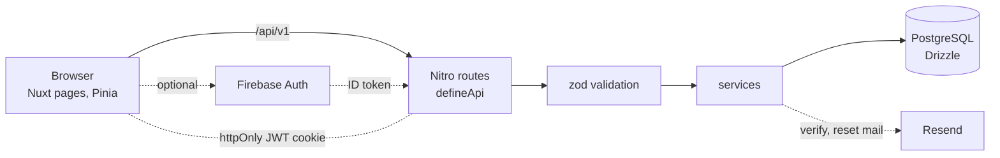
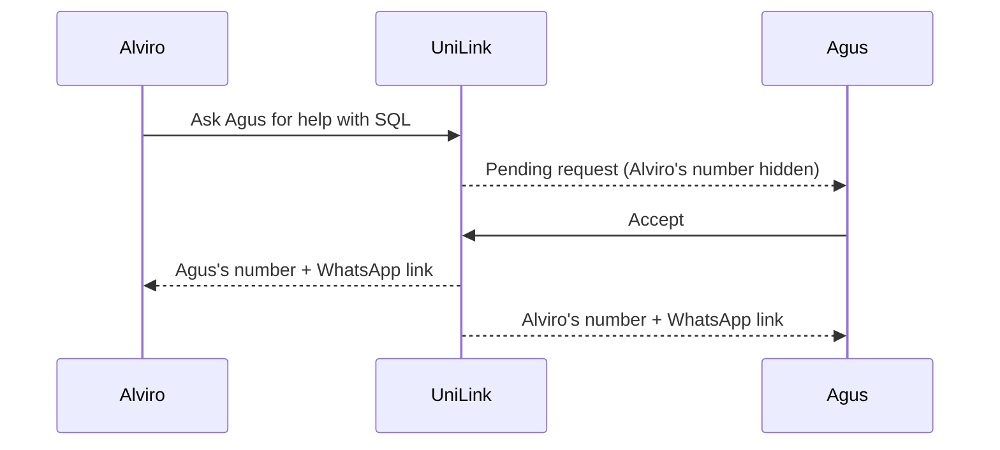
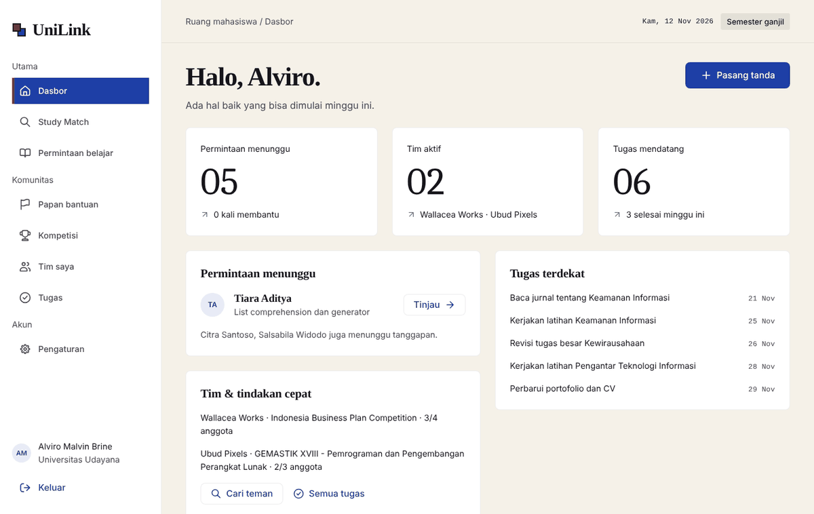
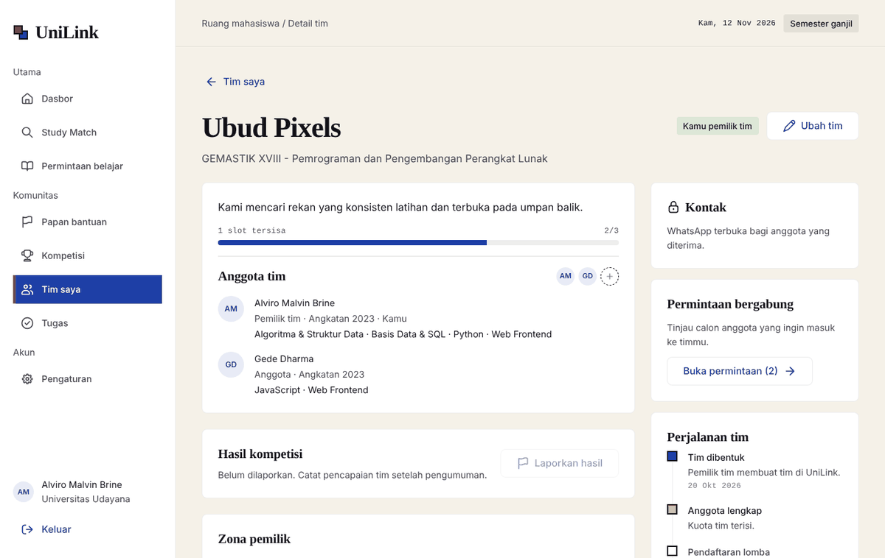
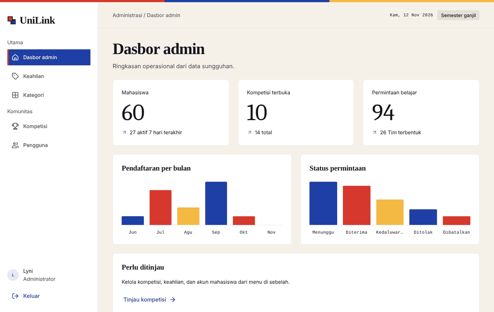
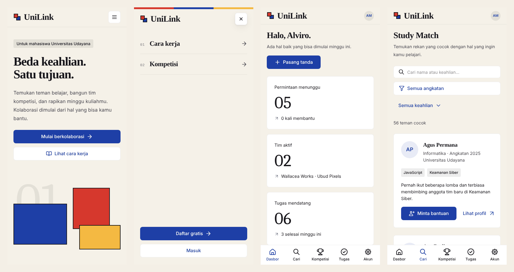

# UniLink

A small web app for Universitas Udayana students: find someone to study with, post what you need help with, put a team together for a competition, and keep track of coursework. Built for TecFest 2026.


## Run it

You need [Bun](https://bun.sh) and a PostgreSQL database.

```bash
cp .env.example .env      # put your DATABASE_URL in it, nothing else is required
bun install
bun run db:reset          # creates tables and fills demo data
bun run dev               # http://localhost:3000
```

Demo logins:

| Role    | Email                        | Password      |
| ------- | ---------------------------- | ------------- |
| Student | `alviro.malvin@unilink.test` | `Student123!` |
| Admin   | `lyni@unilink.test`          | `Admin123!`   |

New accounts finish a short onboarding (name, NIM, year, skills, WhatsApp). The NIM can be entered once and is locked afterwards.

Emails (verification, password reset) are printed to the terminal and listed at `/api/v1/dev/outbox` until you add a `RESEND_API_KEY`. Google sign-in appears only when the Firebase variables in `.env.example` are filled in; without them the app uses its own email and password login.

## How it works



Every route is wrapped in `defineApi`, which checks the session, validates input and returns the same envelope: `{ success, statusCode, message, data }`.

The study-match flow, which is the heart of the app:



Teams work the same way: you ask to join, the owner accepts, and only then do members see each other's numbers.

## Screens

|                                                |                                              |
| ---------------------------------------------- | -------------------------------------------- |
|        |  |
|        |    |
|  |                |
|                |              |

On a phone the sidebar becomes a bottom bar:



## Where things are

```
app/        Nuxt pages, components, Pinia stores, copy in constants/*.json
server/     api routes, services (the logic), validators, emails, Drizzle schema + seeds
postman/    importable collection and environment
docs/       screenshots
```

Stack: Nuxt 4, UnoCSS, Pinia, Drizzle, PostgreSQL, zod, jose, vue-sonner. The visual design is a De Stijl take from Figma: flat colour blocks, thick outlines, nothing glossy.

### Design file

The full De Stijl design lives in Figma — colours, type scale, spacing, and every screen side by side.

[](https://www.figma.com/design/cHIZSLnr7xjhSCfHojQg0M/UniLink---TecFest-2026?node-id=0-1&t=b8fmiaUEH7HvyLXl-1)

## API

Import `postman/UniLink.postman_collection.json` and `postman/UniLink.local.postman_environment.json` into Postman, pick the environment, and run **Auth → Login (student)** once. The cookie is stored for you and every other request just works. All routes are also listed in [API.md](API.md); the client is described in [APP.md](APP.md).

## Handy commands

| Command            | What it does                                             |
| ------------------ | -------------------------------------------------------- |
| `bun run dev`      | start the app                                            |
| `bun run db:reset` | wipe, migrate and reseed (needs `ALLOW_DB_RESET="true"`) |
| `bun run db:seed`  | reseed an already migrated database                      |
| `bun run build`    | production build                                         |
